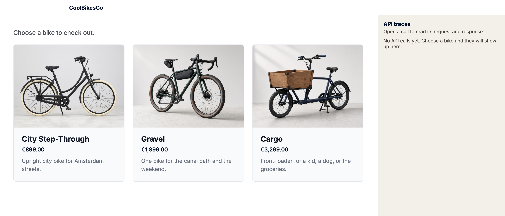
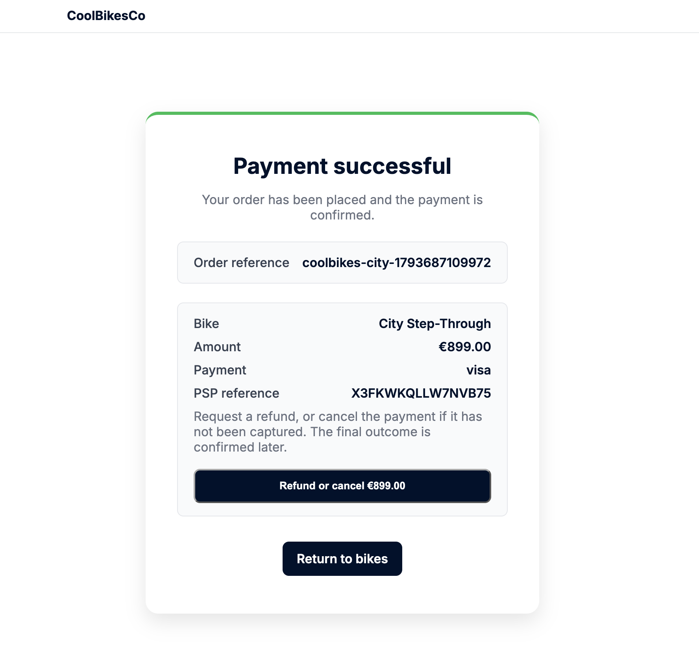

<h1 align="center">CoolBikesCo</h1>

<p align="center">
  A Dutch bike shop demo built with Adyen Sessions and Web Drop-in.<br>
  Choose a bike, follow the API calls, and request a refund or cancellation.
</p>

<p align="center">
  
  
  
  
  
</p>

<p align="center">
  <a href="#run-locally">Run locally</a> ·
  <a href="src/adapters/payments/adyenPayments.js">Integration code</a> ·
  <a href="FRICTION.md">Developer experience notes</a>
</p>

## What it is

CoolBikesCo is a bicycle shop demo for the Netherlands. Shoppers can browse three bikes, pay through Adyen's Drop-in checkout, view their payment invoice, and request a refund or cancellation.

An API trace panel shows the requests and responses as you move through checkout. A separate webhook viewer displays incoming payment events.

<p align="center">
  
</p>

<details>
<summary>Payment result and invoice</summary>
<p align="center">
  
</p>
</details>

## Run locally

With Node.js and npm installed:

```bash
git clone https://github.com/ojusave/coolbikes.git
cd coolbikes
npm install
cp .env.example .env
```

Set `ADYEN_API_KEY`, `ADYEN_CLIENT_KEY`, and `ADYEN_MERCHANT_ACCOUNT` in `.env`. Keep `ADYEN_ENVIRONMENT=TEST` and add `http://127.0.0.1:4317` to the client credential's allowed origins.

```bash
npm start
```

Open **http://127.0.0.1:4317**. Choose a bike, pay with Drop-in, and inspect the API calls beside the checkout. The invoice lets you request a refund or cancellation; acceptance is not the final outcome.

Without API and client keys, the catalog works but no card form appears. Orders are stored in memory and reset on restart.

## Explore

- `/traces` — API requests and responses.
- `/webhooks` — received events; set `ADYEN_HMAC_KEY` to enable signature checks.
- `npm test` — offline tests using fake payments.
- [FRICTION.md](FRICTION.md) — integration findings, AI workflow, and verification limits.

Start with [the Adyen adapter](src/adapters/payments/adyenPayments.js) or [the Drop-in setup](src/public/checkout-adyen.js).
